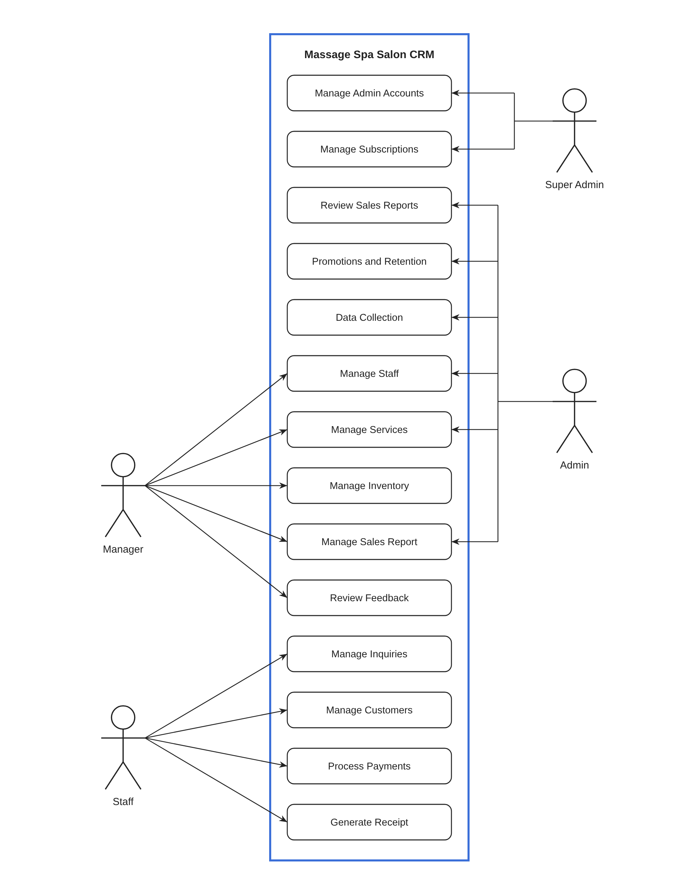

# Massage Spa Salon CRM: Rationale and Use Case Diagram

Files in this folder:

- `use-case-diagram.svg` / `use-case-diagram.png`: the diagram, stacked-box layout (vector and image versions).
- `Rationale_IT13_Spa_Salon_CRM.pdf` / `.docx`: the one-page rationale paper with the diagram.
- `Spa_Salon_CRM_Use_Case.drawio`: editable draw.io version (open it at app.diagrams.net or in the draw.io desktop app).
- `use-case-diagram.puml`: PlantUML source, so the diagram can be edited and regenerated.

---

## 1. Rationale

### 1.1 Background of the problem

Many massage spa salons still run day to day on paper logbooks, chat messages and spreadsheets. Appointments, customer
inquiries, payments and staff schedules are tracked in different places, so:

- customer history (services availed, preferences, visit frequency, complaints) gets lost or is hard to look up;
- sales figures are tallied by hand at the end of the day or month, which is slow and error-prone;
- owners can't tell which customers have stopped coming back, so they have no basis for retention offers;
- feedback from customers is collected informally and rarely acted on;
- staff accounts, roles and access are not controlled, so anyone can see or change sensitive records.

### 1.2 Proposed solution

The **Massage Spa Salon CRM** is a Customer Relationship Management system built in **C# on .NET** that puts customers,
staff, sales and feedback in one database. It is designed as a multi-branch / multi-tenant product: a platform owner
(Super Admin) sells **subscriptions** to salon businesses, and each salon is run by its own Admin, Manager and Staff.

C# / .NET was chosen because:

- it is strongly typed and object-oriented, which maps cleanly to the domain (Customer, Staff, Service, Payment,
  Subscription, Feedback, SalesReport);
- **Entity Framework Core** with **SQL Server** gives a reliable relational store for transactions and reports;
- **ASP.NET Core Identity** provides built-in authentication and **role-based access control**, which is exactly
  what the four actor levels need;
- the same back end can serve a desktop front end (WinForms / WPF) at the counter and a web dashboard for owners.

### 1.3 Objectives

1. Keep one complete record of every customer and their transactions.
2. Speed up front-desk work: inquiries, customer handling and payments.
3. Produce accurate sales reports for management decisions.
4. Use collected customer data and feedback to plan retention strategies.
5. Restrict each user to only the functions their role needs.
6. Let the platform owner manage salon subscriptions and admin accounts centrally.

### 1.4 Scope

**In scope:** account and subscription management, staff management, service and price management, inventory management, promotions, customer inquiries, customer service handling,
payment processing with receipts, sales reporting, feedback review, customer data collection and promotions and retention planning.

**Out of scope (for this version):** payroll, inventory/supplier purchasing, and online customer self-booking. The
customer is not a direct system user in this version: Staff record everything on the customer's behalf, which is why
the customer is not drawn as an actor.

### 1.5 Significance

- **Salon owners (Admin):** get reliable reports and customer data to decide on promos and loyalty programs.
- **Managers:** supervise staff and see customer feedback in one place.
- **Staff:** spend less time on paperwork and more on serving customers.
- **Customers:** get faster service, accurate billing and more personalized treatment.
- **Platform owner (Super Admin):** can onboard and bill many salons from one system.

---

## 2. Actors

The actors form a hierarchy of responsibility, from the platform level down to the front desk.

| Actor | Who they are | Why they are a separate actor |
|---|---|---|
| **Super Admin** | Owner/operator of the CRM platform | Works above any single salon; controls who can use the system and on which plan. |
| **Admin** | Salon owner or business administrator | Makes strategic decisions (sales review, retention, data) for their salon. |
| **Manager** | Branch or shift manager | Runs daily operations: supervises staff, prepares reports, handles feedback. |
| **Staff** | Front desk / receptionist / stylist | Deals with customers directly: inquiries, service and payments. |

---

## 3. Use case descriptions

### Super Admin

| Use case | Description |
|---|---|
| **Manage Admin Accounts** | Create, update, deactivate and reset passwords of salon Admin accounts. |
| **Manage Subscriptions** | Assign, renew, upgrade or cancel each salon's subscription plan and monitor its status (active, expired, unpaid). |

### Admin

| Use case | Description |
|---|---|
| **Review Sales Reports** | View sales figures: revenue per day/month, per service and per therapist. |
| **Promotions and Retention** | Create promos, discounts and loyalty rewards, and identify inactive customers to win back. |
| **Data Collection** | Gather and maintain customer information (profile, visit history, preferences, spending) used for analysis. |
| **Manage Staff** | Add, edit and deactivate staff and manager accounts and set their roles. |
| **Manage Services** | Add, edit and remove spa services (massages, facials, body scrubs, etc.), set their prices and durations, and mark them available or unavailable. |
| **Manage Sales Report** | Shared with Manager: check, approve or correct the sales reports. |

### Manager

| Use case | Description |
|---|---|
| **Manage Staff** | Shared with Admin: maintain staff records, schedules and assignments at the branch level. |
| **Manage Services** | Shared with Admin: keep the branch's service list, prices and availability up to date. |
| **Manage Inventory** | Track supplies such as massage oils, lotions and towels, record stock in and out, and flag low stock. |
| **Manage Sales Report** | Compile transactions into daily, weekly or monthly sales reports. |
| **Review Feedback** | Read customer ratings and comments, flag complaints and follow up with the staff involved. |

### Staff

| Use case | Description |
|---|---|
| **Manage Inquiries** | Record and answer customer questions about services, prices and availability. |
| **Manage Customers** | Register walk-in or returning customers, update their records and assign them to a service and therapist. |
| **Process Payments** | Compute the bill (services, discounts, loyalty points) and accept cash, card or e-wallet payment. |
| **Generate Receipt** | Print or send the official receipt for each completed payment. |

---

## 4. Relationships in the diagram

- **Associations (solid lines)** link each actor to the use cases they are allowed to perform. These double as the
  role permissions to configure in ASP.NET Core Identity.
- **Manage Staff, Manage Services and Manage Sales Report are shared by Admin and Manager.** The Admin oversees
  them for the whole business, while the Manager handles them day to day at the branch. Drawing one use case with
  two actors avoids duplicating the same function.
- **Manage Inventory and Review Feedback belong to the Manager only**, because they are part of running the branch
  day to day. **Promotions and Retention and Data Collection belong to the Admin only**, because they are
  business-level decisions.
- **Data flows upward.** What Staff record (inquiries, customers, payments) becomes the input for the Manager's
  reports, inventory and feedback review, which in turn feed the Admin's promotions and retention plans. Each level
  depends on the level below it, which is why the system serves all four roles from one shared database.
